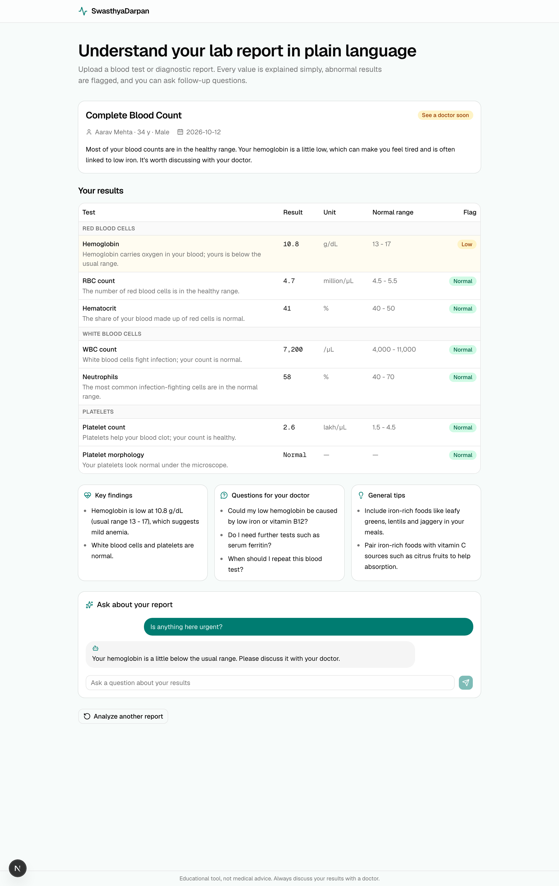
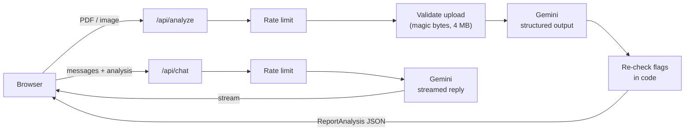

# SwasthyaDarpan

**Understand your lab report in plain language.** Upload a blood test or diagnostic report (PDF or photo). Every value is extracted, explained simply and checked against its normal range, and you can ask follow-up questions about your results.



> Educational tool, not medical advice. Always discuss your results with a doctor.

## Features

- **Structured results.** Each test's value, unit and normal range is pulled into a table, grouped by category, with abnormal results first.
- **Abnormal values checked twice.** The model flags each result, and then the code re-checks every numeric value against its range. The model can't mark a low hemoglobin as "normal".
- **Chat with your report.** Ask follow-up questions. Answers come only from your report's analysis, never from guesses.
- **Try it without uploading anything.** Three synthetic sample reports with fictitious patients run through the real pipeline.
- **Clear failures.** Wrong file type, a non-medical document, or the free quota running out each get a specific message.
- **Light and dark themes.** Follows your system setting by default, with a toggle to force light or dark.
- **Private by design.** Nothing is stored. Files are processed in memory and never written to disk, and report contents are never logged.

## How it works



1. **One model call reads the file directly.** Gemini accepts PDFs and images natively, so there is no separate OCR or parsing service. It returns JSON that must match a [zod schema](lib/schema.ts), so a malformed response fails cleanly instead of rendering garbage.
2. **Code has the final say on flags.** [`lib/flags.ts`](lib/flags.ts) parses values like `"1,250"` and ranges like `"< 200"` or `"13 – 17"`, and overrides the model's flag whenever it can decide.
3. **The server is stateless.** The browser keeps the analysis and sends it back with each chat message, so there's no database or session. Chat sends the extracted JSON, not the original file, which saves tokens and free-tier quota.
4. **Everything goes through one model module.** [`lib/ai/model.ts`](lib/ai/model.ts) picks the model. With `AI_MOCK=1` it swaps in a deterministic mock, which is how the tests and CI run without an API key.

### Why these choices

| Decision | Reason |
| --- | --- |
| A document-reading model instead of OCR followed by an LLM | One service instead of two, and better at tables and phone photos |
| Schema-validated output | The UI can rely on the shape of the data, and invalid output fails loudly |
| Flags re-checked in code | Models occasionally misread ranges, and numeric comparison is cheap and exact |
| Stateless server | Nothing to secure or clean up, and it deploys anywhere |
| Gemini free tier via the Vercel AI SDK | Free to run, and switching to another provider is a one-line change |

## Tech stack

Next.js 16 (App Router) · React 19 · TypeScript · Tailwind CSS 4 · shadcn/ui · Vercel AI SDK 7 with Google Gemini · zod · Vitest · Testing Library · Playwright · GitHub Actions

## Run it locally

You need Node.js 20+ and a free Gemini API key from [Google AI Studio](https://aistudio.google.com/apikey).

```bash
git clone https://github.com/Stroller15/swasthyadarpan-ai.git
cd swasthyadarpan-ai
npm install
cp .env.example .env.local   # then paste your key into GOOGLE_GENERATIVE_AI_API_KEY
npm run dev
```

Open http://localhost:3000 and click a sample report.

To work on the UI without a key, run `AI_MOCK=1 npm run dev`, which returns fixture data.

| Variable | Required | Purpose |
| --- | --- | --- |
| `GOOGLE_GENERATIVE_AI_API_KEY` | Yes, unless mocked | Gemini API key |
| `AI_MODEL` | No | Overrides the Gemini model id (default `gemini-flash-latest`) |
| `AI_MOCK` | No | Set to `1` to use the mock model |

### Free-tier notes

- Google's free tier has daily request limits. The app also limits each visitor to 5 analyses and 30 chat messages per hour.
- Google's free tier may use inputs to improve its products. The app says so on the upload screen, and the samples give visitors a way to try it without real data.

## Testing

```bash
npm test            # unit and component tests (Vitest)
npm run test:e2e    # end-to-end tests (Playwright, mock model)
npm run lint
npm run typecheck
```

CI runs all four on every push and pull request with `AI_MOCK=1`, so it needs no secrets.

To regenerate the sample PDFs from the fixtures, run `npm run samples`.

## Project layout

```
app/
  api/analyze/route.ts    upload → validate → analyze
  api/chat/route.ts       streamed, grounded follow-up chat
  page.tsx
components/               UI (upload, results table, chat, …)
lib/
  ai/                     model selection, prompts, analyzeReport
  schema.ts               the ReportAnalysis contract
  flags.ts                deterministic flag checking
  upload.ts               file validation
  rate-limit.ts, errors.ts
tests/
  unit/                   Vitest
  e2e/                    Playwright
  fixtures/               sample analyses (also used to generate the sample PDFs)
```

## Disclaimer

SwasthyaDarpan explains lab reports for educational purposes only. It does not diagnose conditions or recommend treatment, and it can make mistakes. Always talk to a qualified doctor about your results.
